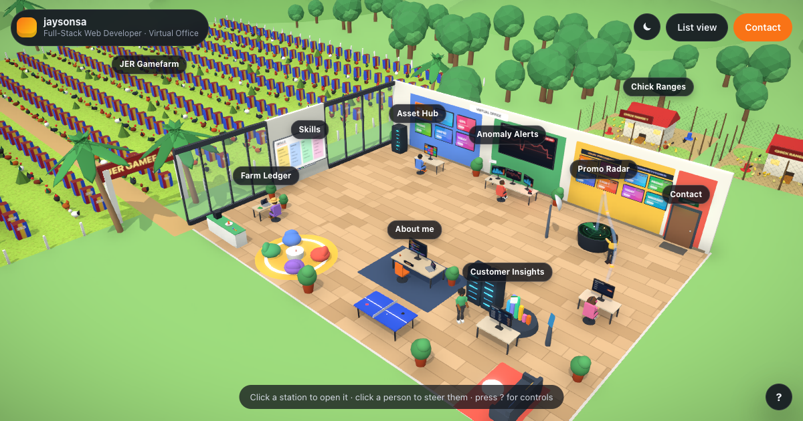

# jaysonsa.github.io

A web developer's portfolio presented as an interactive 3D virtual office: **https://jaysonsa.github.io/**



Each station in the office is a project. Click one and the camera flies over and opens a short case study (problem, solution, engineering highlights, impact, tech, and a mock demo). Virtual teammates work at each station. You can take control of any of them and walk them around the office, out to the JER Gamefarm, or over to the chick ranges.

## Features

- **Case studies as places.** Seven stations with deep links (`/#anomaly-alerts`), keyboard navigation, and a plain list view for quick skimming or devices without WebGL.
- **Controllable teammates.** Click a teammate, then click anywhere to send them there, or steer them with `W A S D`. Routes come from A* on a navigation grid built from the same layout data as the scene, so teammates walk around walls, furniture, teepees, fences, and pens.
- **Day and night.** Lighting, sky, fog, stars, and warm interior lamps all blend from a single value. The site starts in night mode after 6 pm local time.
- **Adaptive rendering.** Ambient occlusion, bloom, SMAA, and soft shadows on capable devices. A performance monitor lowers the quality tier (and pixel ratio) when the frame rate drops. `?quality=low|medium|high` pins a tier.
- **Procedural everything.** Every model is built from primitives and every texture is drawn on a canvas at runtime. There are no external models, images, or fonts, and large repeated sets (300+ teepees, trees, roosters) are instanced.
- **Accessible by default.** Real buttons for labels and controls, focus handling in dialogs, `Esc` everywhere, and `prefers-reduced-motion` support.

## Architecture

```
src/
  world.js        layout data shared by the scene and navigation (farm, ranges, trees, furniture, walls)
  nav.js          navigation grid, A* with an octile heuristic, string-pulling path smoothing
  team.js         teammate definitions and movement commands
  store.js        tiny external store (useSyncExternalStore), shared inside and outside the canvas
  content.js      all copy: profile, case studies, skills
  stations.js     station positions and camera framing
  scene/          React Three Fiber components (lighting, effects, office, outdoor, farm, people)
  ui/             panel, list view, control bar, help dialog
```

Tooling:
- `npm run lint` runs ESLint with React Hooks rules.
- CI lints, builds, and deploys to GitHub Pages on every push to `main`.

## Confidentiality

Work projects appear under generic names with mock data only. This repository contains no company code, assets, data, screenshots, or internal details.

## Editing content

- All text lives in [`src/content.js`](src/content.js).
- Positions are in [`src/world.js`](src/world.js) and [`src/stations.js`](src/stations.js).
- Teammates are defined in [`src/team.js`](src/team.js).

## Local development

```sh
npm install
npm run dev      # http://localhost:5173
npm run lint
npm run build    # production build in dist/
```
